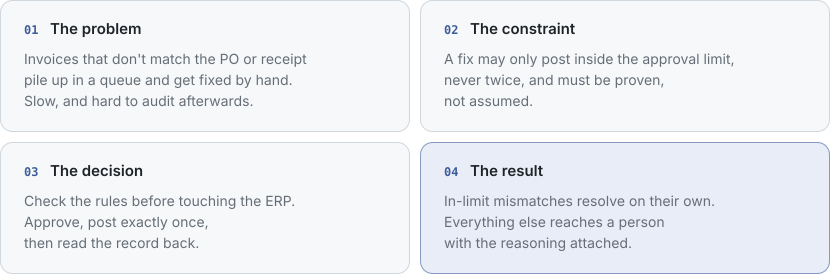
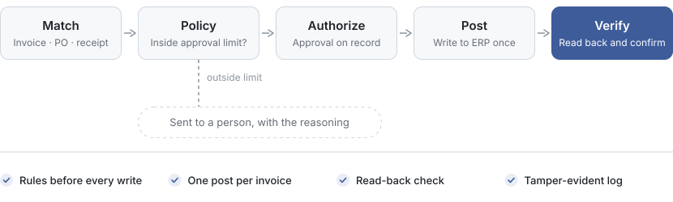
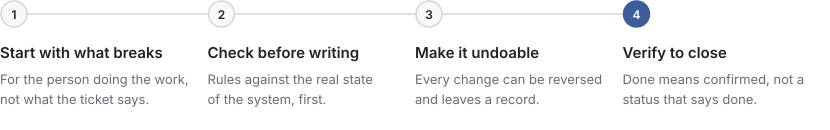
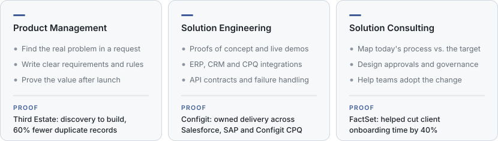

<picture>
  <source media="(prefers-color-scheme: dark)" srcset="assets/header-dark.svg">
  
</picture>

[Portfolio](https://www.vijaykumar.live/) &nbsp;·&nbsp; [LinkedIn](https://www.linkedin.com/in/vk902/) &nbsp;·&nbsp; [Email](mailto:banothvijaykumar01@gmail.com)

Looking for **Solution Engineer and Product** roles that sit between policy, systems, and the people who run them. I'm strongest at taking a vague, recurring operational failure and turning it into a system that behaves the same way every time and can be audited afterwards.

 

### MatchPoint &nbsp;ACCOUNTS PAYABLE

Clearing three-way-match exceptions inside CFO authority, and stopping where a person has to decide.

<picture>
  <source media="(prefers-color-scheme: dark)" srcset="assets/matchpoint-story-dark.svg">
  
</picture>

  

<picture>
  <source media="(prefers-color-scheme: dark)" srcset="assets/matchpoint-flow-dark.svg">
  
</picture>

**Why it matters** &nbsp; AP stops deciding exceptions by whoever has been around longest. Every posting is decided by written policy, approved per record, and can be proven to an auditor later — without a single duplicate payment.

**How it was proven** &nbsp; Built and tested against stateful ERP, supplier, and carrier simulators over real HTTP, failure cases included: 201 automated tests, 22 of them end-to-end in a real browser. Sandbox and live adapters are already in place and fail closed until they are verified against a real system.

[Case study and live demo →](https://www.vijaykumar.live/work#matchpoint)

 

### Same approach, other high-stakes failures

<table>
  <tr>
    <td width="50%" valign="top">
       
      <b><a href="https://www.vijaykumar.live/work#refund-assurance">Refund Assurance</a></b> &nbsp;SERVICE OPS
      
A promised refund fails quietly and the case gets closed anyway. This reopens it as an owned recovery case, only when the failure is confirmed.

      <picture>
        <source media="(prefers-color-scheme: dark)" srcset="assets/refund-flow-dark.svg">
        
      </picture>
      
<b>Guarantee</b> &nbsp;One permission-checked write, proven by an independent read-back.

    </td>
    <td width="50%" valign="top">
       
      <b><a href="https://www.vijaykumar.live/work#business-impact-gate">Business Impact Gate</a></b> &nbsp;SECURITY OPS
      
An analyst is about to isolate a device without knowing what the business loses. This adds that context and stages a dual-approval request instead.

      <picture>
        <source media="(prefers-color-scheme: dark)" srcset="assets/gate-flow-dark.svg">
        
      </picture>
      
<b>Guarantee</b> &nbsp;Zero device changes on its own, and an expired request never counts as approved.

    </td>
  </tr>
</table>

 

### How I work

<picture>
  <source media="(prefers-color-scheme: dark)" srcset="assets/how-i-work-dark.svg">
  
</picture>

 

### Where I fit

<picture>
  <source media="(prefers-color-scheme: dark)" srcset="assets/where-i-fit-dark.svg">
  
</picture>

  

### Background

| | |
|:--|:--|
| **Third Estate Ventures**  Sep 2025 – Jun 2026 | BI & UX Designer, Multi-Project Fellow. Took analysts from discovery to a rebuilt property dataset and the Power BI views they use — 60% fewer duplicate records. |
| **Configit**  Feb 2021 – May 2024 | Solutions Consultant → Senior Solutions Consultant. Turned manufacturers' quote-to-order problems into requirements and owned delivery across Salesforce, SAP, and Configit CPQ. |
| **FactSet**  Dec 2018 – Feb 2021 | Associate → Client Solutions Consultant. Traced institutional clients' data and analytics issues to the platform underneath; helped cut onboarding time by 40%. |
| **Education** | M.S. Management Information Systems, University at Buffalo · B.Tech Computer Science, MNIT Jaipur |
| **Credentials** | CSPO · Lean Six Sigma Green Belt · ITIL 4 |

 

---

**Open to Solution Engineer, Product, and Solutions Consultant conversations.** 
I'm the best fit where the job needs real system design and someone who can explain it to both the people running the process and the people approving it.

[Email](mailto:banothvijaykumar01@gmail.com) &nbsp;·&nbsp; [LinkedIn](https://www.linkedin.com/in/vk902/) &nbsp;·&nbsp; [Portfolio](https://www.vijaykumar.live/)

Every system here is tested against stateful simulations of the real platforms, including how they fail, so the guarantees hold before anything touches production.
